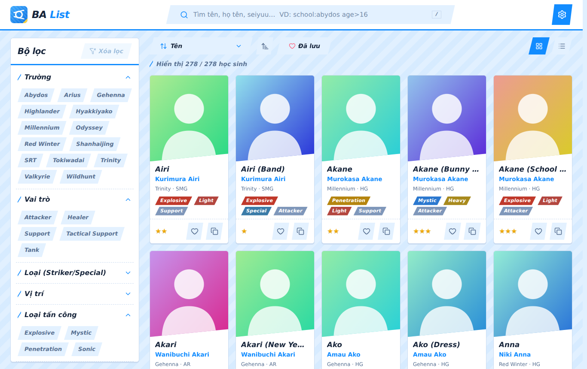
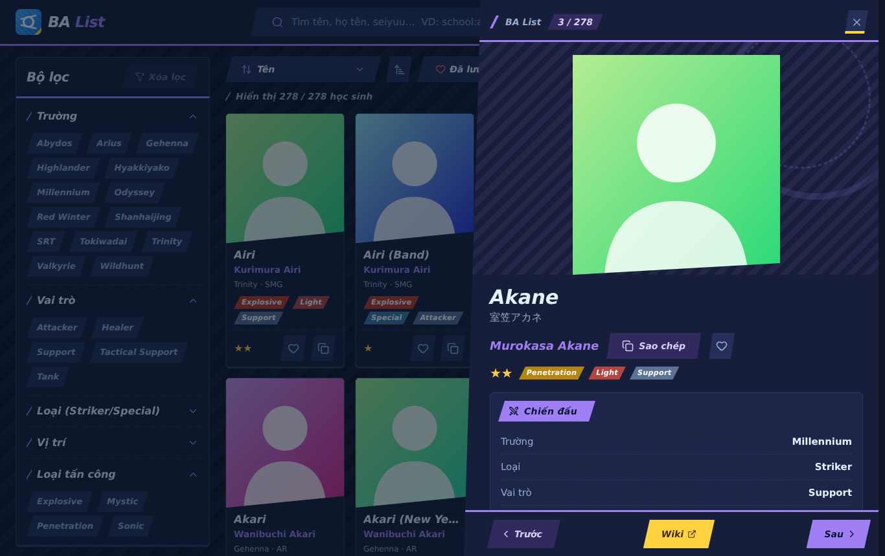
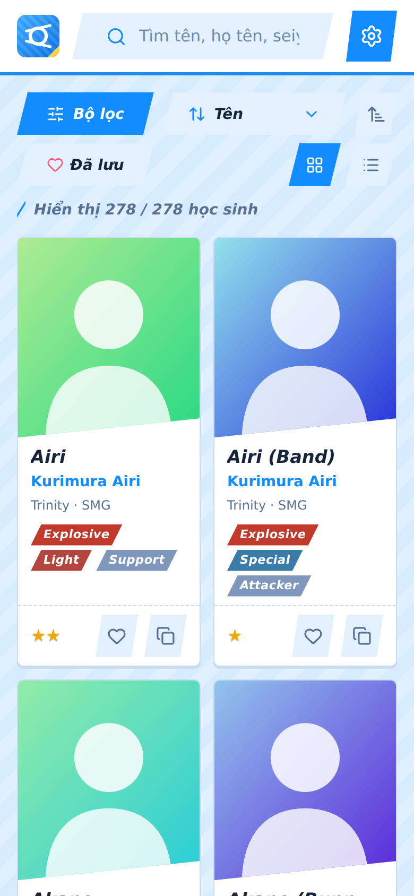
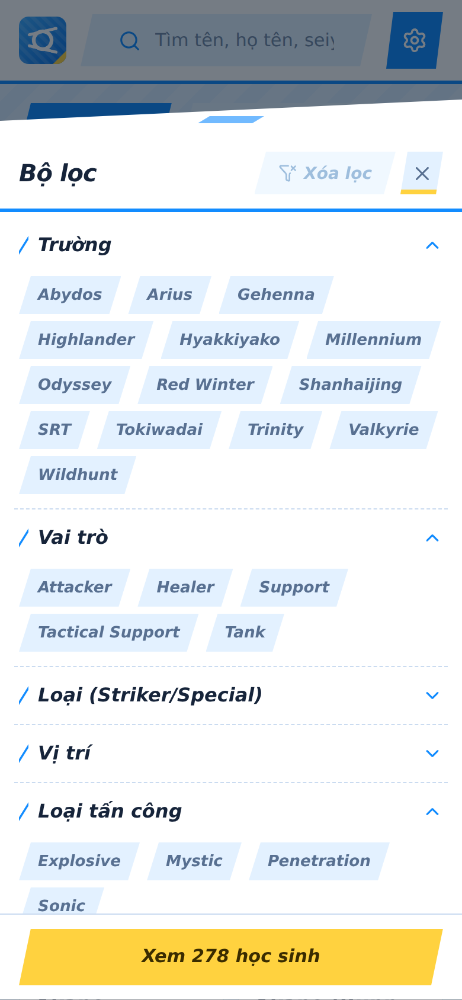

# 🔷 BA List

**BA List** là web tra cứu danh sách học sinh **Blue Archive**: tìm kiếm thông minh, bộ lọc nhiều tiêu chí, xem chi tiết từng học sinh, lưu yêu thích và dùng được offline (PWA).

Dự án gồm hai trang:

| Trang | Đường dẫn | Mô tả |
| --- | --- | --- |
| Landing page | `/` | Trang giới thiệu (HTML tĩnh, đầy đủ meta SEO + Open Graph/Twitter Card + JSON-LD) |
| Ứng dụng | `/app/` | Ứng dụng React tra cứu học sinh |

Xây dựng bằng **React 19 + Vite + Tailwind CSS 4**, giao diện theo phong cách **Blue Archive** (hình bình hành vát chéo, sọc chéo, tiêu đề in nghiêng, xanh dương chủ đạo + vàng nhấn; toàn bộ bảng màu sáng/tối dẫn xuất từ một màu chủ đạo) với icon **Lucide**.

## Ảnh chụp màn hình

| Desktop – sáng | Desktop – tối, chi tiết (side sheet) |
| :---: | :---: |
|  |  |

| Mobile | Mobile – bộ lọc (bottom sheet) |
| :---: | :---: |
|  |  |

> Ảnh chụp dùng ảnh minh họa thay cho ảnh học sinh thật. Hãy chụp lại từ bản chạy thật (cả ảnh trong `public/landing/`) nếu muốn.

## Tính năng

- **Tìm kiếm thông minh**: bỏ dấu tiếng Việt, chịu lỗi gõ sai, xếp hạng theo độ liên quan, gợi ý "Có phải ý bạn là…". Hỗ trợ cú pháp nâng cao.
- **Bộ lọc**: 15 nhóm (trường, vai trò, vị trí, loại tấn công, loại giáp, vũ khí, độ hiếm, địa hình, tháng sinh…), chọn nhiều giá trị, hiển thị chip đang áp dụng.
- **Sắp xếp** theo 12 tiêu chí, đổi chiều, chế độ **lưới / danh sách**.
- **Chi tiết học sinh** dạng sheet (bottom sheet trên mobile, side sheet trên desktop): chuyển trước/sau bằng nút hoặc phím ←/→, các phiên bản khác của cùng nhân vật, link Wiki, deep link `#Tên`.
- **Yêu thích** (lưu trên trình duyệt), lọc "Đã lưu", xuất/nhập danh sách yêu thích.
- **Sao chép họ tên** một chạm, kèm **toast** 4 loại (thành công / thông tin / cảnh báo / lỗi).
- **Cài đặt** (các mục dạng accordion đóng/mở): chế độ sáng/tối/hệ thống, **12 màu chủ đề** + chọn màu tùy ý, ngôn ngữ **Tiếng Việt / English**, **7 font chữ** (System, Google Sans Flex, Roboto Flex, Roboto, Arial, Inter, Be Vietnam Pro), cỡ chữ, bật/tắt hiệu ứng, xuất JSON, cài đặt PWA.
- **Loading kiểu Blue Archive**: vòng halo + skeleton thẻ học sinh khi tải ứng dụng, skeleton có vòng xoay khi ảnh đang tải.
- **Cuộn mượt** (rAF + easing) cho nút "lên đầu trang" và các navlink trên landing page; đổi theme/màu/font được cross-fade bằng View Transitions API.
- **Offline** nhờ service worker, ảnh wiki được cache; font được tự host (không phụ thuộc Google Fonts) và chỉ tải khi được chọn.
- Responsive, dark mode, thanh cuộn tùy chỉnh, kéo thanh nắm để đóng sheet trên mobile. Ảnh trên thẻ luôn sạch (không có huy hiệu hay nút nào đè lên), danh sách render dần để mở sheet mượt.

### Cú pháp tìm kiếm nâng cao

| Ví dụ | Ý nghĩa |
| --- | --- |
| `school:abydos` | lọc theo trường |
| `role:healer weapon:smg` | kết hợp nhiều điều kiện |
| `age>16` · `height<=155` | so sánh số (`>`, `<`, `>=`, `<=`, `=`) |
| `cv:ayumi` · `artist:mx2j` | theo seiyuu / họa sĩ |
| `akane school:millennium` | từ khóa + điều kiện |

Nhấn `/` để focus ô tìm kiếm, `Esc` để xóa.

## Chạy dự án

Yêu cầu Node.js 20+.

```bash
npm install
npm run dev       # chạy dev server (landing: /, ứng dụng: /app/)
npm run build     # build ra thư mục dist/
npm run preview   # xem thử bản build
```

## Triển khai lên GitHub Pages

Repo đã có sẵn workflow `.github/workflows/pages.yml`. Vào **Settings → Pages → Source: GitHub Actions**, sau đó mỗi lần push lên nhánh `main` web sẽ tự build và deploy. Vite dùng `base: './'` nên chạy được ở mọi đường dẫn.

Nếu đổi tên repo/domain, hãy cập nhật các URL tuyệt đối trong `index.html`, `app/index.html`, `public/sitemap.xml` và `public/robots.txt` (canonical, `og:url`, `og:image`, JSON-LD).

## Cấu trúc

```
ba-list/
├── index.html              # landing page (SEO, Open Graph, JSON-LD)
├── app/index.html          # trang ứng dụng React
├── vite.config.js          # 2 entry: index.html + app/index.html
├── public/                 # favicon, icon PWA, manifest, sw.js, og-image, landing/*.webp
├── scripts/gen-fonts.py    # sinh src/fonts/*.css (chỉ subset latin + latin-ext + vietnamese)
├── screenshots/
└── src/
    ├── main.jsx            # entry ứng dụng (lazy load App + BootScreen)
    ├── App.jsx
    ├── landing.js          # script landing: cuộn mượt, scroll-spy, i18n VI/EN, theme
    ├── index.css           # Tailwind + biến màu Blue Archive + hình khối + animation
    ├── data/students.js    # dữ liệu 278 học sinh
    ├── fonts/              # font tự host (nạp lười)
    ├── lib/
    │   ├── search.js       # tìm kiếm, lọc, sắp xếp
    │   ├── scroll.js       # cuộn mượt
    │   ├── fonts.js        # danh sách font + loader
    │   ├── theme.js        # áp màu chủ đạo
    │   ├── i18n.js         # Tiếng Việt / English
    │   ├── students.js     # chuẩn hóa dữ liệu
    │   └── app-context.jsx # cài đặt, toast, yêu thích
    └── components/         # Sheet, DetailSheet, SettingsSheet, FilterPanel, Loading, …
```

## Dữ liệu & bản quyền

Dữ liệu học sinh lấy từ [bluearchive.wiki](https://bluearchive.wiki). Blue Archive và hình ảnh nhân vật thuộc về NEXON Games / Yostar. Dự án phi thương mại, chỉ phục vụ tra cứu.

## Giấy phép

[MIT](LICENSE). Font: Google Sans Flex, Roboto Flex, Roboto, Inter, Be Vietnam Pro dùng giấy phép SIL OFL (qua các gói `@fontsource`).
