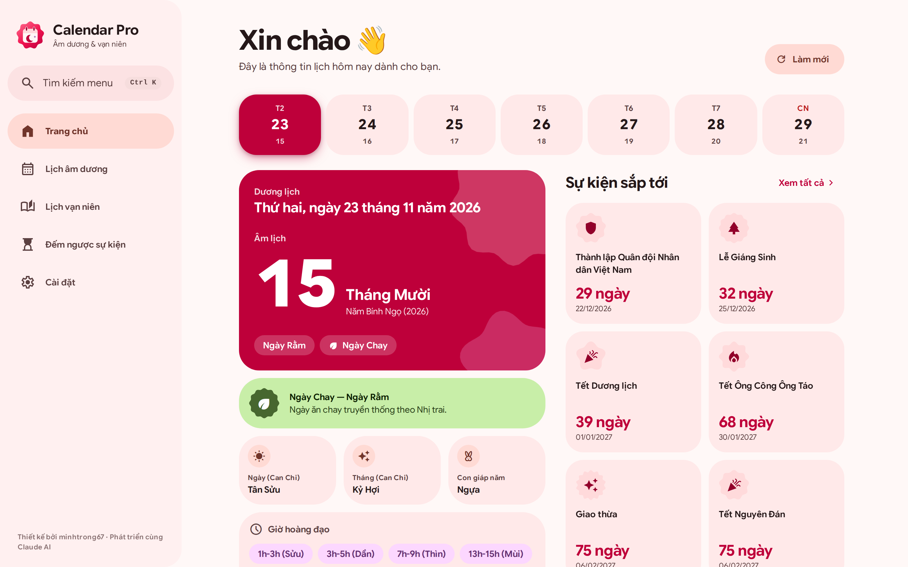
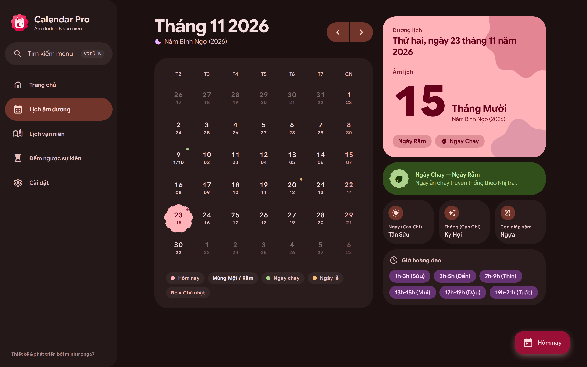
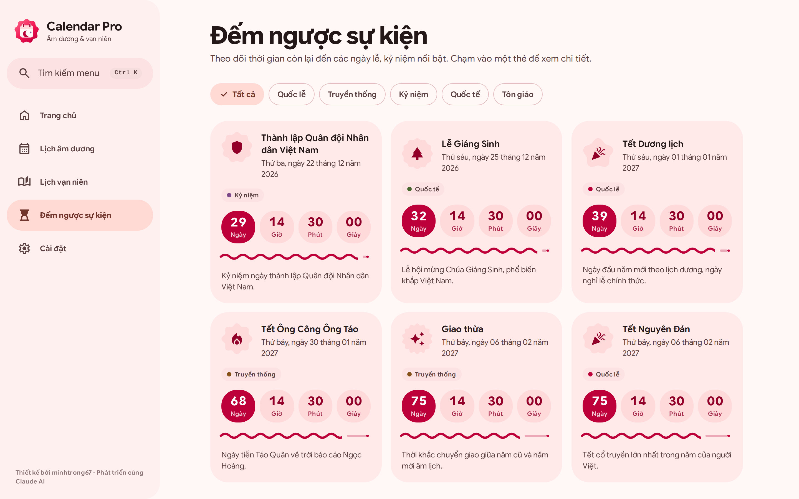
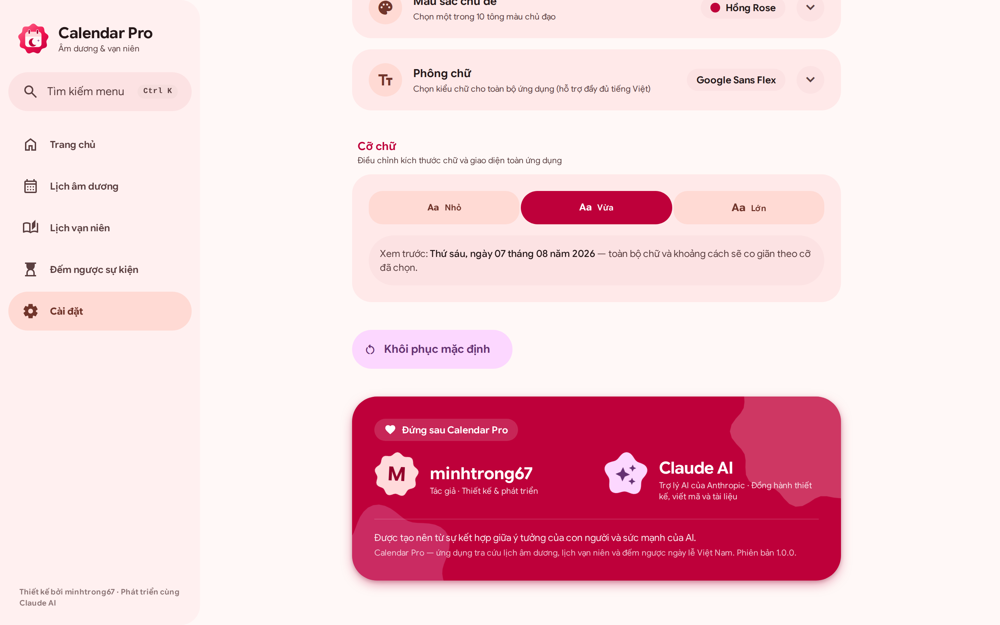

<div align="center">


# Calendar Pro

**Lunar & solar calendar · Perpetual almanac · Vietnamese holiday countdown**<br/>
🌐 **Live:** <https://calendar-pro-rouge.vercel.app/><br/>
Designed to **Material 3 Expressive (2026)** with a **Rose** primary color — fast, installable, works offline.

[](https://react.dev)
[](https://vitejs.dev)
[](https://tailwindcss.com)
[](https://m3.material.io)
[](#-pwa--offline)
[](#-features)

[🇻🇳 Tiếng Việt](README.md) · **🇬🇧 English**

<br/>






<sub>Home · Month calendar (dark) · Event countdown · Settings</sub>

</div>

---

## 📑 Table of contents

- [Overview](#-overview) · [Features](#-features) · [Material 3 Expressive design](#-material-3-expressive-design) · [Settings](#️-settings)
- [Tech stack](#-tech-stack) · [Quick start](#-quick-start) · [Developer customization](#️-developer-customization) · [Project structure](#-project-structure)
- [PWA & offline](#-pwa--offline) · [Deployment](#️-deployment) · [Performance & accessibility](#-performance--accessibility)
- [Browser support](#-browser-support) · [Data & algorithms](#-data--algorithms) · [Credits](#-credits) · [License](#-license)

## 🌟 Overview

**Calendar Pro** is a progressive web app for Vietnam's lunar–solar calendar: a monthly view showing both solar and lunar dates, a detail view for any day (Can Chi, zodiac animal, auspicious hours), two-way solar ↔ lunar conversion, and a countdown to national holidays and observances. Everything runs **in the browser** — no backend, no data collection, and it works offline.

## ✨ Features

| Feature | Description |
|---|---|
| 📅 **Lunar–solar calendar** | Month view with solar and lunar dates side by side; marks new moon, full moon, vegetarian days, holidays and Sundays. Swipe (mobile) or use the buttons to change month; on wide screens the day detail stays pinned on the right. |
| 📖 **Perpetual almanac** | Look up any date: day / month / year Can Chi, zodiac animal, auspicious hours; **two-way conversion** between solar and lunar dates (leap months handled). |
| ⏳ **Event countdown** | A dozen-plus major Vietnamese holidays and anniversaries (Lunar New Year, Hung Kings' Festival, National Day, Mid-Autumn…) with a live clock, wavy progress indicator and category filters. |
| 🌿 **Vegetarian & full-moon days** | The two traditional monthly fasting days (1st & 15th, *Nhị trai*) are marked on the calendar, home and day detail. |
| 🏠 **Home** | Today at a glance: 7-day strip, large lunar day, Can Chi, auspicious hours, upcoming events. |
| 🔎 **Quick search** | `Ctrl/Cmd + K` opens a command palette to jump to any page. |
| 🌐 **Multi-language** | Vietnamese / English across the whole UI, remembered between visits. |
| 🎨 **Personalization** | Light / Dark / System, 10 primary colors, 7 typefaces, 3 font sizes. |
| 📱 **PWA** | Installable, works offline via a Service Worker. |

## 🎨 Material 3 Expressive design

| Aspect | How it's applied |
|---|---|
| **Color** | A dynamic *vibrant* scheme generated from the primary color — default **Rose** (seed `#FF2056` → primary `#BE003A`). Full primary / secondary / tertiary / surface-container roles in four modes: light, dark, and both high-contrast. "Vegetarian" and "holiday" colors are *harmonized* with the primary. |
| **Shape** | Large radii (28–48 px), borderless tonal cards; the selected day and icons use **cookie / scallop / flower / sunny** shapes; buttons morph on press; connected button groups. |
| **Motion** | **Spring** tokens (spatial / spatial-fast / spatial-slow) generated as bouncy `linear()` easings; color and opacity use non-bouncy curves. Disabled under *reduced motion*. |
| **Type** | Expressive type scale (bold headlines, tight tracking) plus a choice of 7 typefaces. |
| **Navigation** | Sidebar with a spring-sliding indicator (≥ 1024 px), navigation rail (640–1023 px), floating bottom bar on mobile; the mobile header shows the **current page name**. |

**Animation & effects:** diagonal-wave day cells on month change · cookie-shaped selected day · rolling odometer numbers · flowing wavy progress · morphing loading indicator · ripple + state layers · pointer-following spotlight · slowly rotating decorative shapes · scroll-driven reveal · circular light/dark reveal from the click point · springy toasts, sheets and dialogs.

## ⚙️ Settings

Open **Settings** in the app. The long groups (**Theme color**, **Typeface**) are *accordions* — collapsed by default, with the current value always visible in the header.

| Group | Options |
|---|---|
| **Appearance** | Light · Dark · System |
| **Language** | Tiếng Việt · English |
| **Theme color** | **Rose** *(default)* · Mono · Đỏ Son · Vàng Kim · Xanh Ngọc · Xanh Dương · Tím Huế · Hồng Đào · Cam Sen · Ngọc Lam — or *change daily* / *pick randomly* |
| **Typeface** | **System** *(default)* · Google Sans Flex · Roboto Flex · Roboto · Arial · Inter · Be Vietnam Pro (all with full Vietnamese support) |
| **Font size** | Small (92.5 %) · **Medium** (100 %, default) · Large (110 %) |
| **Install app** | PWA install card (only when the browser allows it) |
| **Reset** | Restore every option to its default (with confirmation) |

Preferences are stored in `localStorage` (`calendar-pro:settings`) and applied from the very first frame by a boot script in `index.html`, so there is no flash of the wrong theme on reload.

## 🧱 Tech stack

| Layer | Technology |
|---|---|
| UI | React 18 + React Router 6 (HashRouter) |
| Styling | Tailwind CSS 3 + Material 3 Expressive tokens (color, shape, spring) |
| Theme generation | [`@material/material-color-utilities`](https://github.com/material-foundation/material-color-utilities) → `scripts/generate-theme.mjs` |
| Icons | Google Material Symbols Outlined (subset-loaded) |
| Fonts | [Fontsource](https://fontsource.org) — self-hosted, loaded on demand |
| Build | Vite 5 |
| PWA | `vite-plugin-pwa` (Workbox) |
| Lunar algorithm | Hồ Ngọc Đức's astronomical algorithm (GMT+7) |

## 🚀 Quick start

**Requirements:** Node.js ≥ 18.

```bash
git clone <repo-url> calendar-pro && cd calendar-pro
npm install
npm run dev        # http://localhost:5173
```

| Command | Purpose |
|---|---|
| `npm run dev` | Start the dev server (HMR) |
| `npm run build` | Production build into `dist/` |
| `npm run preview` | Preview the production build |
| `npm run theme` | Regenerate colors / springs / shapes from `src/theme/colors.json` |
| `npm run icons` | Regenerate favicon, app icons, `og-image` *(Python + Playwright + Pillow)* |
| `npm run build && npm run screenshots` | Re-shoot the 4 images in `screenshots/` *(Python + Playwright)* |

> The last two are for maintaining image assets only: `pip install playwright pillow && playwright install chromium`.

## 🛠️ Developer customization

<details>
<summary><b>Change the default primary color / add a color</b></summary>

Edit `src/theme/colors.json` (`id`, `label`, `seed`) and run `npm run theme`. It generates `material-theme.css` (every role × light/dark/high-contrast), `motion.css`, `shapes.css`, `swatches.json`, `surfaces.json` and the `SURF` block in `index.html` (boot background). The default is the entry with `id: "rose"` plus `DEFAULTS.color` in `SettingsContext.jsx`.
</details>

<details>
<summary><b>Add a typeface</b></summary>

`npm i @fontsource-variable/<font>` and add an entry to `FONT_OPTIONS` in `src/lib/fonts.js` (`id`, `label`, `stack`, `load: () => import('…/wght.css')`). Fonts load only when selected; pick one that ships a `vietnamese` subset.
</details>

<details>
<summary><b>Add holidays / UI strings</b></summary>

- Holidays: `src/data/holidays.js` (`solar` or `lunar`, category, icon, description).
- UI strings: `src/i18n/translations.js` — add the key to both the `vi` and `en` branches.
</details>

## 📁 Project structure

```
calendar-pro/
├── public/                  # favicon, og-image, icons/ (any · maskable · monochrome · apple-touch)
├── screenshots/             # the 4 showcase images (README + landing)
├── landing/index.html       # static landing page
├── scripts/                 # generate-theme.mjs · generate-icons.py · screenshots.py
├── src/
│   ├── components/          # Layout, Sidebar, NavRail, BottomNav, Header, Accordion, RollingNumber, WavyProgress…
│   ├── contexts/            # SettingsContext (theme, color, typeface, size, language), ToastContext
│   ├── data/holidays.js     # holidays & vegetarian days
│   ├── hooks/               # useNow, useModal, useExitTransition, usePwaInstall, useMediaQuery
│   ├── i18n/                # translations.js, useTranslation.js
│   ├── lib/                 # lunar.js, dateUtils.js, fonts.js, ripple.js, themeTransition.js
│   ├── pages/               # Home, Calendar, VanNien, Countdown, Settings, NotFound
│   ├── theme/               # colors.json (seeds) + generated CSS/JSON
│   └── index.css, main.jsx, App.jsx
└── index.html · tailwind.config.js · vite.config.js · package.json
```

## 📱 PWA & offline

- A Workbox Service Worker precaches the app; fonts and icons are cached on first use.
- **Settings** shows an "Install app" card when the browser fires its install event, and a confirmation once installed.
- The manifest ships `any`, `maskable` and `monochrome` icons and Rose-based start-up colors.

## ☁️ Deployment

A static site (`dist/`) using **HashRouter**, so **no server rewrites are needed**.

```bash
npm run build
```

Vercel / Netlify / Cloudflare Pages: build command `npm run build`, output directory `dist`. GitHub Pages: publish `dist/` to `gh-pages`. `landing/index.html` is a standalone static page (set `APP_URL` at the end of the file so "Open app" points at your deployment).

## ⚡ Performance & accessibility

**Performance**
- Route-level code splitting; web fonts load on demand; the icon font contains only the glyphs in use.
- A single delegated listener each for ripple and spotlight; animations use `transform` / `opacity` only.
- **Smooth light/dark switching:** when the OS changes theme it is applied *instantly* (one style recalculation); when the user clicks, the circular reveal uses a View Transition with a synchronous callback. The old per-element `transition` on every node is gone.

**Accessibility**
- Honors `prefers-reduced-motion` and `prefers-contrast: more`; 3 px keyboard focus ring.
- Accordions use `aria-expanded` / `aria-controls` and make collapsed content `inert`; buttons, switches and option groups carry proper `aria-*`; large touch targets (mostly ≥ 48 px).
- Rolling numbers expose their real value via `aria-label`.

## 🌍 Browser support

Current Chrome, Edge, Safari and Firefox. Modern features are used as progressive enhancement with fallbacks: View Transitions (circular theme reveal), `linear()` easing (springs), scroll-driven animation, `inert`, `color-mix()`.

## 🧮 Data & algorithms

- Solar ↔ lunar conversion uses **Hồ Ngọc Đức**'s astronomical algorithm in GMT+7; highly accurate for modern years.
- Vegetarian days follow **Nhị trai** (1st & 15th of the lunar month), the most common convention; it may differ from a specific tradition's or person's fasting calendar.
- The holiday list is a compilation of common Vietnamese holidays and observances, provided for reference.

## 🙌 Credits

| | |
|---|---|
| **Author** | **minhtrong67** — concept, design and development |
| **AI assistant** | **Claude AI** (Anthropic) — partner in UI design, code and documentation |
| Lunar algorithm | Hồ Ngọc Đức |
| Design system & icons | Google Material 3 Expressive, Material Symbols |
| Typefaces | Google Sans Flex, Roboto Flex, Roboto, Inter, Be Vietnam Pro (via Fontsource) |

The author and Claude AI credit is also highlighted on the app's **Settings** page.

## 📄 License

Built for personal learning / reference. Third-party fonts, icons and libraries remain under their own licenses.

<div align="center"><sub>Designed by <b>minhtrong67</b> · Built with <b>Claude AI</b></sub></div>
