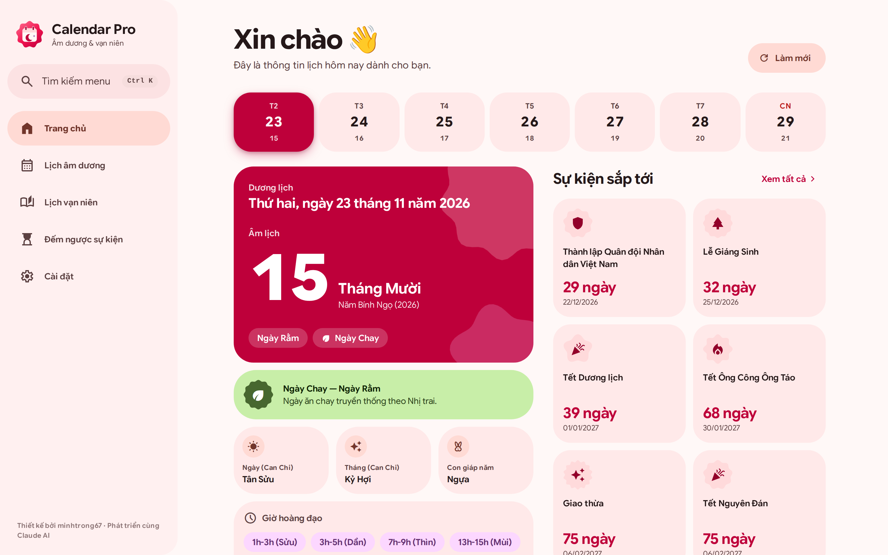
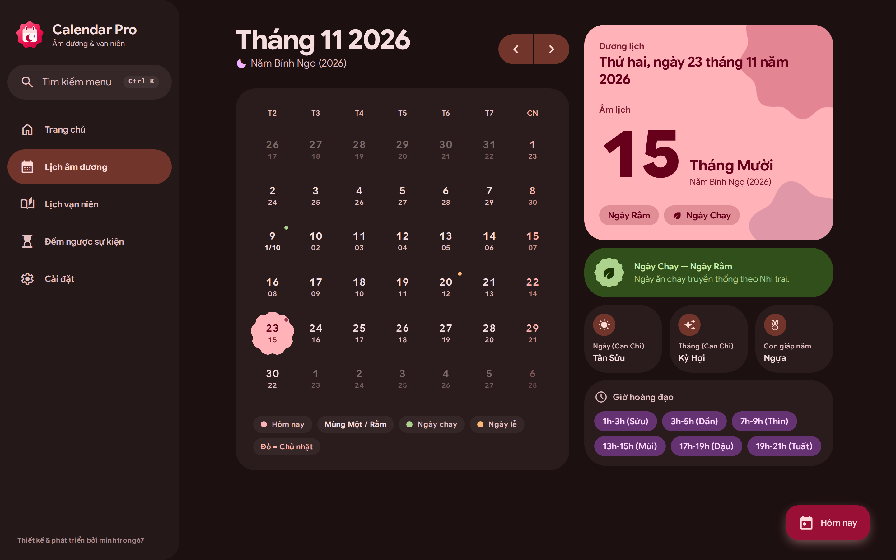
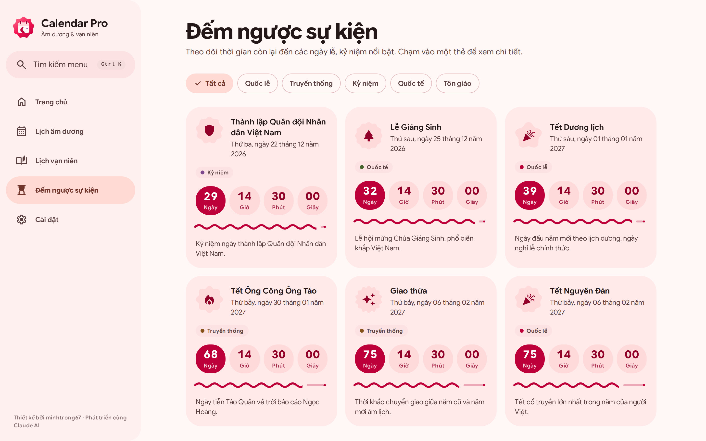
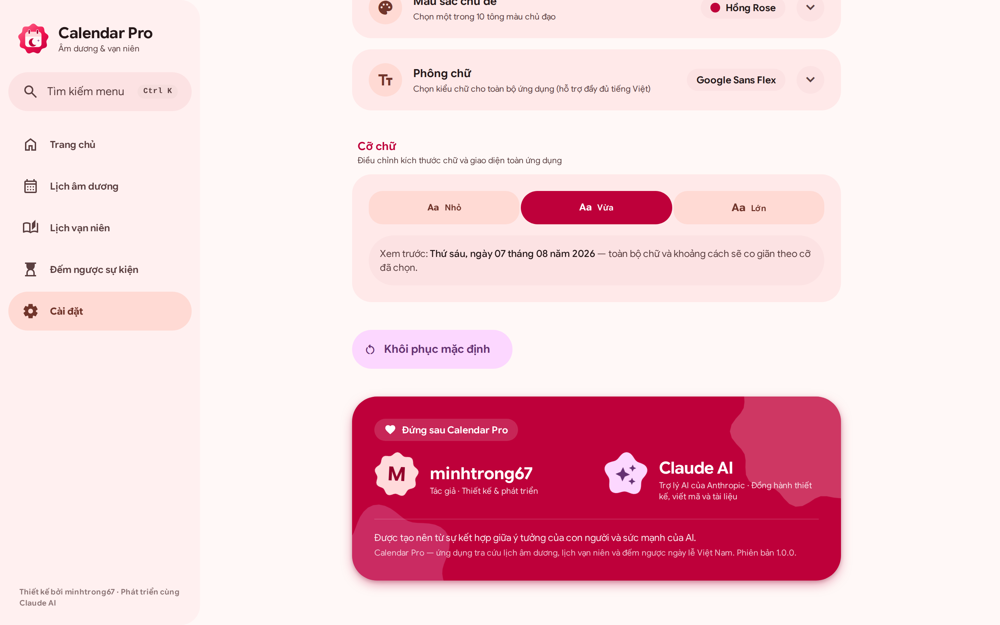

<div align="center">


# Calendar Pro

**Lịch âm dương · Lịch vạn niên · Đếm ngược ngày lễ Việt Nam**<br/>
🌐 **Dùng thử:** <https://calendar-pro-rouge.vercel.app/><br/>
Thiết kế theo chuẩn **Material 3 Expressive (2026)** với màu chủ đạo **Rose** — chạy nhanh, dùng được offline.

[](https://react.dev)
[](https://vitejs.dev)
[](https://tailwindcss.com)
[](https://m3.material.io)
[](#-pwa--offline)
[](#-đa-ngôn-ngữ)

**🇻🇳 Tiếng Việt** · [🇬🇧 English](README.en.md)

<br/>






<sub>Trang chủ · Lịch tháng (chế độ tối) · Đếm ngược · Cài đặt</sub>

</div>

---

## 📑 Mục lục

- [Giới thiệu](#-giới-thiệu)
- [Tính năng](#-tính-năng)
- [Thiết kế Material 3 Expressive](#-thiết-kế-material-3-expressive)
- [Cài đặt tuỳ chỉnh](#-cài-đặt-tuỳ-chỉnh)
- [Công nghệ](#-công-nghệ)
- [Bắt đầu nhanh](#-bắt-đầu-nhanh)
- [Tuỳ biến cho nhà phát triển](#-tuỳ-biến-cho-nhà-phát-triển)
- [Cấu trúc dự án](#-cấu-trúc-dự-án)
- [PWA & offline](#-pwa--offline)
- [Triển khai](#-triển-khai)
- [Hiệu năng & khả năng truy cập](#-hiệu-năng--khả-năng-truy-cập)
- [Trình duyệt hỗ trợ](#-trình-duyệt-hỗ-trợ)
- [Dữ liệu & thuật toán](#-dữ-liệu--thuật-toán)
- [Ghi công](#-ghi-công)
- [Giấy phép](#-giấy-phép)

## 🌟 Giới thiệu

**Calendar Pro** là ứng dụng web (PWA) tra cứu lịch âm dương Việt Nam: xem lịch theo tháng với cả ngày dương và ngày âm, tra chi tiết một ngày (Can Chi, con giáp, giờ hoàng đạo), quy đổi dương ↔ âm và đếm ngược tới các ngày lễ, kỷ niệm. Toàn bộ xử lý diễn ra **ngay trên trình duyệt** — không cần máy chủ, không thu thập dữ liệu, mở được cả khi mất mạng.

## ✨ Tính năng

| Tính năng | Mô tả |
|---|---|
| 📅 **Lịch âm dương** | Lịch tháng hiển thị đồng thời ngày dương và âm; đánh dấu mùng một, rằm, ngày chay, ngày lễ, Chủ nhật. Vuốt ngang (di động) hoặc dùng nút để đổi tháng; trên màn hình rộng, chi tiết ngày nằm cố định bên phải. |
| 📖 **Lịch vạn niên** | Tra cứu một ngày bất kỳ: Can Chi ngày / tháng / năm, con giáp, giờ hoàng đạo; **quy đổi hai chiều** dương lịch ↔ âm lịch (có xử lý tháng nhuận). |
| ⏳ **Đếm ngược** | Gần 30 ngày lễ, kỷ niệm (Tết Nguyên Đán, Giáng Sinh, Halloween, Giỗ Tổ Hùng Vương, Quốc khánh, Trung Thu…) với đồng hồ thời gian thực, thanh tiến trình dạng sóng, lọc theo danh mục. Ngày đặc biệt có thẻ giao diện riêng theo chủ đề; chạm vào để xem sheet toàn màn hình với ý nghĩa, phong tục và điều thú vị. |
| 🌿 **Ngày chay & rằm** | Tự động đánh dấu hai ngày ăn chay theo *Nhị trai* (Mùng Một và Rằm) trên lịch, trang chủ và chi tiết ngày. |
| 🏠 **Trang chủ** | Tổng quan hôm nay: dải 7 ngày trong tuần, ngày âm lịch cỡ lớn, Can Chi, giờ hoàng đạo, các sự kiện sắp tới. |
| 🔎 **Tìm kiếm nhanh** | `Ctrl/Cmd + K` mở bảng lệnh để nhảy tới bất kỳ trang nào. |
| 🌐 **Đa ngôn ngữ** | Tiếng Việt / English cho toàn bộ giao diện, ghi nhớ lựa chọn. |
| 🎨 **Cá nhân hoá** | Sáng / Tối / Theo hệ thống, 10 màu chủ đạo, 7 phông chữ, 3 cỡ chữ. |
| 📱 **PWA** | Cài vào màn hình chính, chạy offline nhờ Service Worker. |

## 🎨 Thiết kế Material 3 Expressive

| Khía cạnh | Cách áp dụng |
|---|---|
| **Màu** | Bảng màu động dạng *vibrant* sinh từ màu chủ đạo — mặc định **Rose** (seed `#FF2056` → primary `#BE003A`). Đủ vai trò primary / secondary / tertiary / surface-container ở 4 chế độ: sáng, tối, sáng & tối tương phản cao. Màu "chay" và "ngày lễ" được *harmonize* về màu chủ đạo. |
| **Hình dạng** | Bo góc lớn 28–48 px, thẻ tonal không viền; ngày đang chọn và icon dùng các hình **cookie / scallop / flower / sunny**; nút biến hình khi nhấn; connected button group. |
| **Chuyển động** | Token **spring** (spatial / spatial-fast / spatial-slow) sinh thành easing `linear()` có độ nảy; màu & độ trong suốt dùng đường cong không nảy. Tự tắt khi bật *giảm chuyển động*. |
| **Chữ** | Thang chữ Expressive (tiêu đề đậm, tracking âm) + 7 phông chữ để chọn. |
| **Điều hướng** | Sidebar có chỉ báo trượt bằng spring (≥ 1024 px), navigation rail (640–1023 px), thanh điều hướng nổi (floating) trên di động; header di động hiển thị **tên trang đang xem**. |

**Hiệu ứng & animation:** ô ngày nảy ra theo làn sóng chéo khi đổi tháng · ngày chọn dạng cookie xoay-nảy · số cuộn (odometer) cho đồng hồ và ngày âm · thanh tiến trình dạng sóng đang chảy · loading indicator biến hình · ripple + state layer · ánh sáng spotlight đi theo con trỏ · hình trang trí xoay chậm · thẻ hiện dần khi cuộn (scroll-driven animation) · đổi sáng/tối lan tròn từ điểm bấm · toast / sheet / hộp thoại vào bằng spring.

## ⚙️ Cài đặt tuỳ chỉnh

Vào trang **Cài đặt** trong ứng dụng. Các nhóm dài (**Màu sắc chủ đề**, **Phông chữ**) là *accordion* — đóng sẵn, tiêu đề luôn hiển thị giá trị đang dùng; bấm để mở.

| Mục | Lựa chọn |
|---|---|
| **Chế độ giao diện** | Sáng · Tối · Hệ thống (theo hệ điều hành) |
| **Ngôn ngữ** | Tiếng Việt · English |
| **Màu sắc chủ đề** | **Hồng Rose** *(mặc định)* · Đơn sắc · Đỏ Son · Vàng Kim · Xanh Ngọc · Xanh Dương · Tím Huế · Hồng Đào · Cam Sen · Ngọc Lam — hoặc *đổi màu mỗi ngày* / *chọn ngẫu nhiên* |
| **Phông chữ** | **System** *(mặc định)* · Google Sans Flex · Roboto Flex · Roboto · Arial · Inter · Be Vietnam Pro (đều đủ dấu tiếng Việt) |
| **Cỡ chữ** | Nhỏ (92,5 %) · **Vừa** (100 %, mặc định) · Lớn (110 %) |
| **Cài đặt ứng dụng** | Thẻ cài PWA (chỉ hiện khi trình duyệt cho phép) |
| **Khôi phục mặc định** | Đưa mọi tuỳ chỉnh về ban đầu (có hộp thoại xác nhận) |

Tuỳ chỉnh được lưu trong `localStorage` (khoá `calendar-pro:settings`) và áp dụng ngay từ khung hình đầu tiên (script khởi động trong `index.html`), nên không bị nháy sai màu khi tải lại.

## 🧱 Công nghệ

| Thành phần | Công nghệ |
|---|---|
| UI | React 18 + React Router 6 (HashRouter) |
| Styling | Tailwind CSS 3 + token Material 3 Expressive (màu, hình dạng, spring) |
| Sinh theme | [`@material/material-color-utilities`](https://github.com/material-foundation/material-color-utilities) → `scripts/generate-theme.mjs` |
| Icon | Google Material Symbols Outlined (chỉ tải đúng các icon đang dùng) |
| Phông chữ | [Fontsource](https://fontsource.org) — tự host, tải theo nhu cầu |
| Build | Vite 5 |
| PWA | `vite-plugin-pwa` (Workbox) |
| Âm lịch | Thuật toán thiên văn Hồ Ngọc Đức (GMT+7) |

## 🚀 Bắt đầu nhanh

**Yêu cầu:** Node.js ≥ 18.

```bash
git clone <repo-url> calendar-pro && cd calendar-pro
npm install
npm run dev        # http://localhost:5173
```

| Lệnh | Tác dụng |
|---|---|
| `npm run dev` | Chạy môi trường phát triển (HMR) |
| `npm run build` | Build bản production vào `dist/` |
| `npm run preview` | Chạy thử bản production |
| `npm run theme` | Sinh lại bảng màu / spring / hình dạng từ `src/theme/colors.json` |
| `npm run icons` | Sinh lại favicon, app icon, `og-image` *(Python + Playwright + Pillow)* |
| `npm run build && npm run screenshots` | Chụp lại 4 ảnh trong `screenshots/` *(Python + Playwright)* |

> Hai script cuối chỉ dành cho người bảo trì tài nguyên hình ảnh: `pip install playwright pillow && playwright install chromium`.

## 🛠️ Tuỳ biến cho nhà phát triển

<details>
<summary><b>Đổi màu chủ đạo mặc định / thêm màu mới</b></summary>

Sửa `src/theme/colors.json` (`id`, `label`, `seed`) rồi chạy `npm run theme`. Script sinh:

- `src/theme/material-theme.css` — toàn bộ vai trò màu cho mỗi màu × (sáng, tối, tương phản cao)
- `src/theme/motion.css`, `src/theme/shapes.css` — token spring và hình dạng
- `src/theme/swatches.json`, `surfaces.json` và khối `SURF` trong `index.html` (màu nền khởi động)

Màu mặc định là mục có `id: "pink"` và giá trị `DEFAULTS.color` trong `SettingsContext.jsx`.
</details>

<details>
<summary><b>Thêm phông chữ</b></summary>

`npm i @fontsource-variable/<tên-font>` rồi thêm một mục vào `FONT_OPTIONS` trong `src/lib/fonts.js` (`id`, `label`, `stack`, `load: () => import('…/wght.css')`). Font chỉ được tải khi người dùng chọn; hãy chọn font có subset `vietnamese`.
</details>

<details>
<summary><b>Thêm ngày lễ / ngôn ngữ</b></summary>

- Ngày lễ: `src/data/holidays.js` (loại `solar` hoặc `lunar`, danh mục, icon, mô tả).
- Chuỗi giao diện: `src/i18n/translations.js` — thêm khoá vào cả hai nhánh `vi` và `en`.
</details>

## 📁 Cấu trúc dự án

```
calendar-pro/
├── public/                  # favicon, og-image, icons/ (any · maskable · monochrome · apple-touch)
├── screenshots/             # 4 ảnh giới thiệu (README + landing)
├── landing/index.html       # trang giới thiệu tĩnh
├── scripts/
│   ├── generate-theme.mjs   # sinh màu M3 Expressive + spring + hình dạng
│   ├── generate-icons.py    # sinh favicon / app icon / og-image
│   └── screenshots.py       # chụp 4 ảnh trong screenshots/
├── src/
│   ├── components/          # Layout, Sidebar, NavRail, BottomNav, Header, Accordion, RollingNumber, WavyProgress…
│   ├── contexts/            # SettingsContext (giao diện, màu, phông, cỡ chữ, ngôn ngữ), ToastContext
│   ├── data/holidays.js     # ngày lễ & ngày chay
│   ├── hooks/               # useNow, useModal, useExitTransition, usePwaInstall, useMediaQuery
│   ├── i18n/                # translations.js, useTranslation.js
│   ├── lib/                 # lunar.js, dateUtils.js, fonts.js, ripple.js, themeTransition.js
│   ├── pages/               # Home, Calendar, VanNien, Countdown, Settings, NotFound
│   ├── theme/               # colors.json (seed) + CSS/JSON tự sinh
│   └── index.css, main.jsx, App.jsx
└── index.html · tailwind.config.js · vite.config.js · package.json
```

## 📱 PWA & offline

- Service Worker (Workbox) precache toàn bộ ứng dụng; font chữ và icon được cache khi dùng lần đầu.
- Trang **Cài đặt** hiển thị thẻ "Cài đặt ứng dụng" khi trình duyệt phát sự kiện cài đặt; sau khi cài sẽ hiện dòng xác nhận đã cài.
- Manifest có icon `any`, `maskable`, `monochrome` và màu khởi động theo bảng màu Rose.

## ☁️ Triển khai

Ứng dụng là một site tĩnh (`dist/`), dùng **HashRouter** nên **không cần cấu hình rewrite** trên máy chủ.

```bash
npm run build      # xuất ra dist/
```

Vercel / Netlify / Cloudflare Pages: Build command `npm run build`, Output directory `dist`. GitHub Pages: đẩy nội dung `dist/` lên nhánh `gh-pages`. Trang `landing/index.html` là file tĩnh độc lập (đặt biến `APP_URL` ở cuối file để nút "Mở ứng dụng" trỏ tới URL thật).

## ⚡ Hiệu năng & khả năng truy cập

**Hiệu năng**
- Mọi trang được nạp lười (code-splitting); font web chỉ tải khi chọn; bộ icon chỉ gồm các glyph đang dùng.
- Một listener duy nhất cho ripple và spotlight (event delegation); animation chỉ dùng `transform` / `opacity`.
- **Đổi sáng/tối không giật:** theme do hệ điều hành đổi được áp *tức thì* (một lần tính lại style); khi người dùng bấm đổi, hiệu ứng lan tròn dùng View Transition với callback đồng bộ. Không còn `transition` trên mọi phần tử như trước.

**Khả năng truy cập**
- Tôn trọng `prefers-reduced-motion` và `prefers-contrast: more`; vòng focus 3 px cho bàn phím.
- Accordion: `aria-expanded` / `aria-controls`, nội dung đóng được đặt `inert`; nút, switch, nhóm lựa chọn có `aria-*` đầy đủ; mục tiêu chạm lớn (chủ yếu ≥ 48 px).
- Trình đọc màn hình đọc đúng giá trị của số cuộn (`aria-label`).

## 🌍 Trình duyệt hỗ trợ

Chrome / Edge / Safari / Firefox bản hiện hành. Các tính năng nâng cao được dùng theo kiểu *progressive enhancement* và có phương án dự phòng: View Transitions (đổi theme lan tròn), `linear()` easing (spring), scroll-driven animation, `inert`, `color-mix()`.

## 🧮 Dữ liệu & thuật toán

- Chuyển đổi âm ↔ dương theo thuật toán thiên văn của **Hồ Ngọc Đức**, múi giờ GMT+7; độ chính xác cao cho các năm hiện đại.
- Ngày chay mặc định theo **Nhị trai** (Mùng Một & Rằm) — cách tính phổ biến nhất, có thể khác lịch chay của từng tông phái hay cá nhân.
- Danh sách ngày lễ là tổng hợp các ngày lễ, kỷ niệm phổ biến, mang tính tham khảo.

## 🙌 Ghi công

| | |
|---|---|
| **Tác giả** | **minhtrong67** — ý tưởng, thiết kế và phát triển |
| **Trợ lý AI** | **Claude AI** (Anthropic) — đồng hành thiết kế giao diện, viết mã và tài liệu |
| Thuật toán âm lịch | Hồ Ngọc Đức |
| Hệ thiết kế & icon | Google Material 3 Expressive, Material Symbols |
| Phông chữ | Google Sans Flex, Roboto Flex, Roboto, Inter, Be Vietnam Pro (qua Fontsource) |

Thông tin tác giả và Claude AI cũng được nêu bật trong trang **Cài đặt** của ứng dụng.

## 📄 Giấy phép

Dự án được xây dựng cho mục đích học tập / tham khảo cá nhân. Các phông chữ, icon và thư viện bên thứ ba tuân theo giấy phép riêng của từng dự án.

<div align="center"><sub>Thiết kế bởi <b>minhtrong67</b> · Phát triển cùng <b>Claude AI</b></sub></div>


## Phát triển

```bash
npm run dev          # chạy thử
npm test             # unit test (lịch âm, ngày lễ, xuất .ics)
npm run lint         # ESLint
npm run icons:check  # kiểm tra danh sách icon trong index.html khớp với code (build tự đồng bộ: npm run icons:sync)
npm run build
```

Sự kiện cá nhân (sinh nhật, kỷ niệm, ngày giỗ — dương hoặc âm lịch) được lưu trong `localStorage` của trình duyệt, không gửi lên máy chủ.
