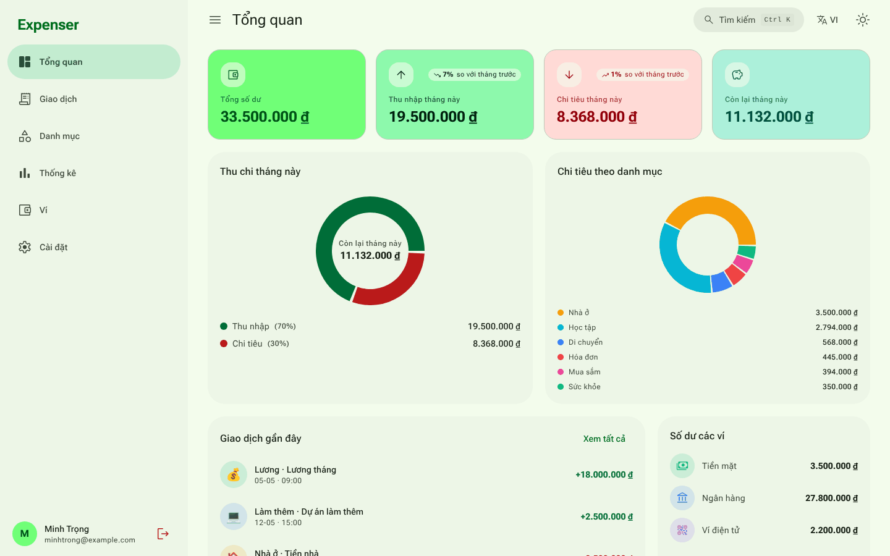
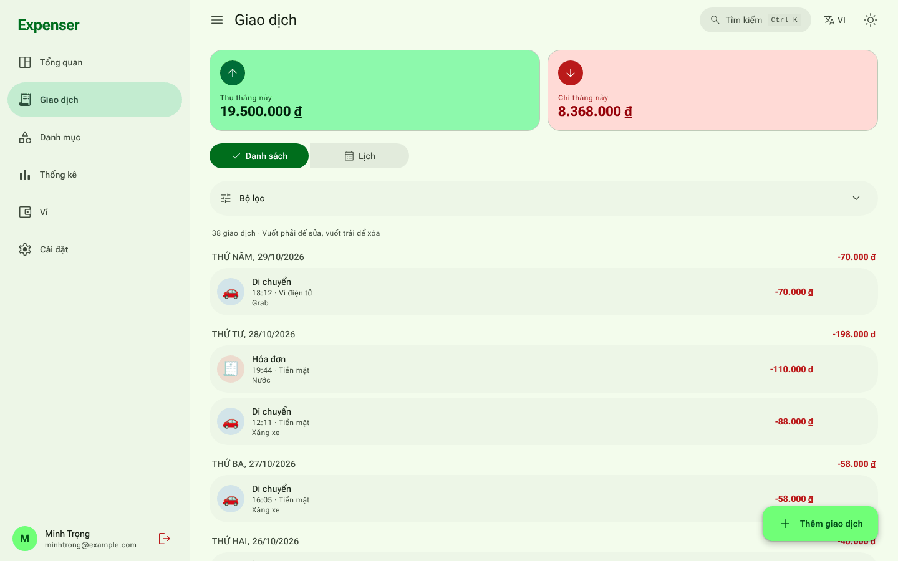
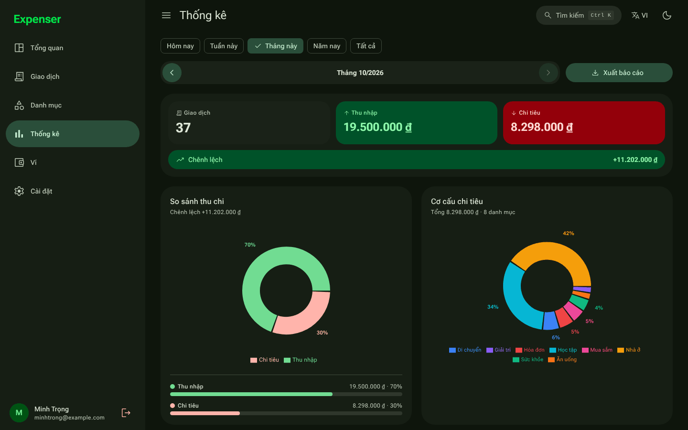
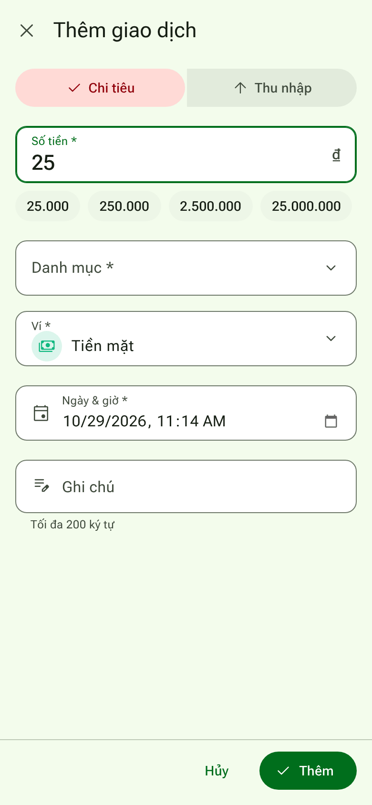

<div align="center">


# Expenser

**Quản lý chi tiêu cá nhân — nhanh, gọn, mã nguồn mở.**
<br />
*A fast, open-source personal expense tracker with a Material 3 Expressive interface.*

[](https://expenser-eight.vercel.app/)


[Dùng thử](https://expenser-eight.vercel.app/) ·
[Tính năng](#-tính-năng) ·
[Cài đặt](#-bắt-đầu) ·
[Nhắc nhở hàng ngày](#-nhắc-nhở-hàng-ngày-thông-báo-đẩy) ·
[Thiết kế](#-hệ-thống-thiết-kế)



</div>

---

## Mục lục

- [Giới thiệu](#-giới-thiệu)
- [Ảnh chụp màn hình](#-ảnh-chụp-màn-hình)
- [Tính năng](#-tính-năng)
- [Công nghệ](#-công-nghệ)
- [Bắt đầu](#-bắt-đầu)
- [Nhắc nhở hàng ngày (thông báo đẩy)](#-nhắc-nhở-hàng-ngày-thông-báo-đẩy)
- [Scripts](#-scripts)
- [Hệ thống thiết kế](#-hệ-thống-thiết-kế)
- [Luồng điều hướng](#-luồng-điều-hướng)
- [Cấu trúc dự án](#-cấu-trúc-dự-án)
- [Mô hình dữ liệu](#-mô-hình-dữ-liệu)
- [Triển khai](#-triển-khai)
- [Trình duyệt hỗ trợ](#-trình-duyệt-hỗ-trợ)
- [Giấy phép](#-giấy-phép)

## 📖 Giới thiệu

**Expenser** giúp bạn ghi lại thu chi trong vài giây, theo dõi nhiều ví, xem thống kê trực quan và xuất báo cáo (PDF / Excel / ảnh). Ứng dụng ưu tiên thao tác một tay trên điện thoại, cài được như ứng dụng thật (PWA), vẫn dùng được khi mất mạng và nhắc bạn ghi chép mỗi ngày.

| | |
| --- | --- |
| 🎨 **Material 3 Expressive** | Màu xanh lá tươi, góc bo lớn, nút biến hình khi nhấn, chuyển động lò xo; chế độ sáng / tối / theo hệ thống, đổi được màu chủ đạo. |
| ⚡ **Nhập liệu nhanh** | Gợi ý số tiền một chạm: gõ `2` → `2.000 · 20.000 · 200.000 · 2.000.000`. |
| 🔔 **Nhắc nhở hàng ngày** | Thông báo đẩy đẹp mắt, bật/tắt và đổi giờ trong Cài đặt (mặc định 06:00). |
| 🌐 **Song ngữ** | Tiếng Việt / English, ngày giờ và tiền tệ tự định dạng theo ngôn ngữ. |
| 📴 **Offline-first** | PWA cài lên màn hình chính, Firestore lưu đệm và tự đồng bộ khi có mạng. |
| 🔓 **Mã nguồn mở** | Phát hành theo giấy phép MIT. |

## 🖼️ Ảnh chụp màn hình

| | |
| :---: | :---: |
| <br/>**Tổng quan** (sáng) | <br/>**Giao dịch** (sáng) |
| <br/>**Thống kê** (tối) | <br/>**Thêm giao dịch trên di động + gợi ý số tiền** |

## ✨ Tính năng

### Quản lý tài chính

| Tính năng | Mô tả |
| --- | --- |
| **Tổng quan** | Số dư, thu/chi tháng này (so với tháng trước), biểu đồ tròn, cơ cấu chi tiêu, giao dịch gần đây và số dư từng ví. |
| **Giao dịch** | Xem dạng danh sách (nhóm theo ngày) hoặc lịch tháng; lọc, tìm kiếm, sắp xếp; vuốt phải để sửa, vuốt trái để xóa; tự tải thêm khi cuộn. |
| **Nhập nhanh** | **Gợi ý số tiền**: gõ `2` để chọn `2.000`, `20.000`, `200.000` hoặc `2.000.000`; gõ `25` ra `25.000 … 25.000.000`. Có thêm gợi ý các mục đã nhập gần đây (số tiền, danh mục, ví). |
| **Danh mục** | Thêm / sửa / xóa danh mục thu và chi với emoji và màu tùy chỉnh. |
| **Nhiều ví** | Số dư từng ví và chuyển tiền giữa các ví. |

### Thống kê & báo cáo

- Lọc theo **Hôm nay / Tuần này / Tháng này / Năm nay / Tất cả**, điều hướng sang kỳ trước/sau.
- Biểu đồ xu hướng, so sánh thu–chi và biểu đồ tròn theo danh mục.
- Xuất báo cáo **PDF / Excel / ảnh PNG**, tất cả đều có biểu đồ tròn.
- Nhập / xuất **giao dịch** và **danh mục** riêng biệt (CSV, Excel `.xlsx`, JSON) cùng nút **Xuất tất cả**; nhập hàng loạt nhanh nhờ ghi theo lô.

### Trải nghiệm

- **Trang giới thiệu (landing)** là trang mặc định cho khách chưa đăng nhập: responsive đầy đủ, sáng/tối/hệ thống, Việt/Anh, hiệu ứng cuộn mượt, ô nhập số tiền dùng thử ngay và thẻ SEO đầy đủ. Người đã đăng nhập vào thẳng ứng dụng; nút **Giới thiệu** trong Cài đặt mở lại trang này.
- **Đăng nhập** bằng Google với giao diện chia đôi chuyên nghiệp, có nút quay về trang chủ.
- **Nhắc nhở hàng ngày**: bật/tắt và chỉnh giờ trong Cài đặt, nút *Gửi thử thông báo* để xem trước.
- **Toast** kiểu snackbar M3, đổi màu ngay khi chuyển sáng/tối.
- Chế độ **Sáng / Tối / Theo hệ thống**, **màu chủ đạo** (mặc định xanh lá, 8 màu gợi ý hoặc bất kỳ — cả bảng màu M3 tự tạo lại), cỡ chữ 3 mức.
- Form nhiều trường mở dạng sheet toàn màn hình; form ngắn và hộp xác nhận dùng dialog; không tự focus để tránh bật bàn phím.
- Bộ lọc từng trang và trạng thái các mục Cài đặt được nhớ trong phiên.
- Tìm kiếm nhanh **Ctrl + K**; hoạt ảnh gọn nhẹ, tôn trọng `prefers-reduced-motion`.
- **PWA**: cài lên màn hình chính, dùng offline, màn hình khởi động dùng nền mặc định, không kiểm tra sáng/tối.
- Truy cập tốt: nhãn ARIA, điều hướng bàn phím, bẫy focus trong hộp thoại.

## 🧰 Công nghệ

| Thành phần | Công nghệ |
| --- | --- |
| Frontend | React 19, Vite 8, React Router 7 |
| Giao diện | Tailwind CSS 3, **Material 3 Expressive** (vai trò màu M3 sinh từ seed xanh lá bằng `@material/material-color-utilities`), font Roboto Flex, icon Material Symbols Rounded |
| Backend | Firebase Authentication + Cloud Firestore (persistent cache) |

| Biểu đồ | Recharts |
| Xuất / nhập | jsPDF + autoTable, ExcelJS, PapaParse, Canvas API |
| PWA | vite-plugin-pwa (Workbox) |
| Công cụ | oxlint, script kiểm tra i18n |

## 🚀 Bắt đầu

**Yêu cầu:** Node.js ≥ 18 và một dự án [Firebase](https://console.firebase.google.com/).

```bash
git clone <repo-url>
cd expenser
pnpm install
```

> Dự án dùng **pnpm** (cài bằng `npm i -g pnpm` hoặc `corepack enable`). Các script build của dependency (esbuild, @firebase/util…) được khai báo sẵn trong `pnpm-workspace.yaml`, nên không cần chạy `pnpm approve-builds`.

**1. Tạo Firebase project**

1. Firebase Console → **Add project**.
2. **Authentication → Sign-in method**: bật **Google**.
3. **Firestore Database → Create database**.
4. **Project settings → Your apps → Web app**: sao chép `firebaseConfig`.

**2. Biến môi trường** — sao chép `.env.example` thành `.env` rồi điền:

```env
VITE_FIREBASE_API_KEY=xxxxx
VITE_FIREBASE_AUTH_DOMAIN=xxxxx.firebaseapp.com
VITE_FIREBASE_PROJECT_ID=xxxxx
VITE_FIREBASE_STORAGE_BUCKET=xxxxx.appspot.com
VITE_FIREBASE_MESSAGING_SENDER_ID=xxxxx
VITE_FIREBASE_APP_ID=xxxxx

# Tùy chọn - chỉ cần khi muốn thông báo đẩy khi đã đóng ứng dụng (xem phần bên dưới)
VITE_VAPID_PUBLIC_KEY=
```

**3. Security Rules** — dán nội dung [`firestore.rules`](firestore.rules) vào tab **Rules** (mỗi người dùng chỉ đọc/ghi dữ liệu của chính mình; thêm quy tắc cho collection `reminders`).

**4. Authorized domains** — *Authentication → Settings → Authorized domains*: thêm `localhost` và tên miền triển khai.

**5. Chạy thử**

```bash
pnpm dev
```

## 🔔 Nhắc nhở hàng ngày (thông báo đẩy)

Trong **Cài đặt → Nhắc nhở hàng ngày**, người dùng có thể bật/tắt thông báo, chọn giờ (mặc định **06:00** theo múi giờ thiết bị) và bấm **Gửi thử thông báo** để xem trước.

Thông báo được thiết kế riêng: biểu tượng ứng dụng, huy hiệu đơn sắc trên thanh trạng thái, ảnh banner khi mở rộng, nội dung xoay vòng theo ngày bằng tiếng Việt hoặc Anh, hai nút hành động **Thêm chi tiêu / Thêm thu nhập**, và chạm vào thông báo sẽ mở thẳng form thêm giao dịch (`/?add=expense`, `/?add=income`).

Ứng dụng dùng ba đường gửi, tự chọn đường tốt nhất có sẵn:

| Cách | Khi nào hoạt động | Cần cấu hình |
| --- | --- | --- |
| **Web Push** (khuyên dùng) | Cả khi ứng dụng đã đóng | Khóa VAPID + Vercel Function + bộ hẹn giờ (bên dưới) |
| **Periodic Background Sync** | Chrome/Android, PWA đã cài, giờ không chính xác tuyệt đối | Không |
| **Hẹn giờ trong trang** | Khi ứng dụng đang mở hoặc chạy nền | Không |

Cả ba dùng chung một `tag` nên mỗi ngày chỉ hiện một thông báo.

### Bật Web Push trên Vercel

1. Sinh khóa VAPID: `pnpm vapid` (in ra *public key* và *private key*).
2. Đặt `VITE_VAPID_PUBLIC_KEY` (public key) vào `.env` và **Environment Variables** của Vercel.
3. Thêm các biến **chỉ dùng phía máy chủ** trên Vercel:

   | Biến | Ý nghĩa |
   | --- | --- |
   | `FIREBASE_SERVICE_ACCOUNT` | JSON service account (Firebase Console → Project settings → Service accounts), dán trên một dòng |
   | `VAPID_PUBLIC_KEY` / `VAPID_PRIVATE_KEY` | Cặp khóa ở bước 1 |
   | `VAPID_SUBJECT` | `mailto:ban@example.com` |
   | `CRON_SECRET` | Chuỗi bí mật dài, ngẫu nhiên |
   | `REMINDER_WINDOW_MINUTES` | (tùy chọn) Trễ tối đa vẫn gửi, mặc định 90 |

4. Triển khai lại, rồi **gọi `/api/send-reminders` mỗi ~10 phút**, ví dụ:
   - **GitHub Actions** (miễn phí): dùng sẵn [`.github/workflows/reminders.yml`](.github/workflows/reminders.yml), chỉ cần thêm secret `REMINDER_URL` (`https://<tên-miền>/api/send-reminders`) và `CRON_SECRET`.
   - Vercel Cron (gói Pro cho phép chạy thường xuyên hơn 1 lần/ngày) hoặc dịch vụ như cron-job.org, gửi kèm header `Authorization: Bearer <CRON_SECRET>`.

> Gói Hobby của Vercel chỉ cho cron chạy một lần mỗi ngày nên cần bộ hẹn giờ bên ngoài như trên.

Mỗi thiết bị bật nhắc nhở lưu một tài liệu trong collection `reminders` (đăng ký push, giờ, múi giờ, ngôn ngữ). Tài liệu bị xóa khi người dùng tắt nhắc nhở, đăng xuất, hoặc khi dịch vụ push báo đăng ký đã hết hạn.

**Lưu ý nền tảng:** trên iPhone cần iOS 16.4+ và phải *Thêm vào Màn hình chính* trước khi cấp quyền thông báo. Nếu trình duyệt đang chặn thông báo, Cài đặt sẽ hiển thị hướng dẫn mở lại.

## 🛠️ Scripts

| Lệnh | Tác dụng |
| --- | --- |
| `pnpm dev` | Dev server tại `http://localhost:5173` (thêm `--host` để mở trên điện thoại cùng mạng LAN). |
| `pnpm build` | Build production vào `dist/` (kèm service worker). |
| `pnpm preview` | Chạy thử bản build. |
| `pnpm lint` | Kiểm tra code bằng oxlint. |
| `pnpm i18n:check` | Kiểm tra mọi khóa dịch có đủ ở `vi.js` và `en.js`. |
| `pnpm vapid` | Sinh cặp khóa VAPID cho thông báo đẩy. |

**Thêm / sửa văn bản:** mọi chuỗi hiển thị nằm trong [`src/i18n/vi.js`](src/i18n/vi.js) và [`src/i18n/en.js`](src/i18n/en.js). Dùng `const t = useT()` rồi `t('khóa', { n: 3 })`; trong tiếng Anh, khóa kết thúc `_one` là dạng số ít khi `n === 1`.

## 🎨 Hệ thống thiết kế

Phong cách **Material 3 Expressive (2026)**: màu xanh lá đậm và tươi, góc bo lớn, bề mặt tông màu thay cho viền, nút/FAB **biến hình** (tròn ↔ vuông bo) khi nhấn, chuyển động **lò xo** nảy nhẹ, loading indicator biến hình, thanh điều hướng dưới có pill chỉ báo và icon đặc khi được chọn.

| Thành phần | Chi tiết |
| --- | --- |
| **Màu** | Màu chủ đạo mặc định là xanh lá (seed `#4CAF50`, scheme *Vibrant*). Toàn bộ vai trò màu M3 (`--md-primary`, `--md-surface-container-*`…) cho sáng + tối nằm trong [`src/theme/colors.css`](src/theme/colors.css) — **file sinh tự động**: đổi `SEED` trong [`src/theme/scheme.js`](src/theme/scheme.js) rồi chạy `node scripts/gen-theme.mjs`. |
| **Hình khối** | Thang bo góc M3 Expressive trong [`src/theme/theme.css`](src/theme/theme.css): `--shape-xs` 4 → `--shape-xl` 28 → `--shape-xxl` 48 → `--shape-full`; Tailwind `rounded-*` ánh xạ vào các token này. |
| **Chuyển động** | `--motion-spatial` / `--motion-spatial-fast` (lò xo, hàm `linear()`), `--motion-effects` (không nảy); dùng qua `ease-spatial`, `ease-effects`. Tôn trọng `prefers-reduced-motion`. |
| **Chữ** | Roboto Flex (variable, gói sẵn qua `@fontsource-variable/roboto-flex`, có tiếng Việt, dùng được offline); thang chữ M3 trong `tailwind.config.js`. |
| **Icon** | Material Symbols Rounded, đóng gói dạng path trong `src/components/ui/iconMap.js` (**file sinh tự động**: `node scripts/gen-icons.mjs`). |
| **App icon / favicon** | Ví trên nền hình "cookie" 12 cánh `#70FF77` (primary container) + bản maskable vuông; `public/favicon.svg|ico`, `public/icons/*`. |

**Đổi màu chủ đạo.** Trong Cài đặt có 8 màu gợi ý và bộ chọn màu tự do. Khi chọn màu khác, một scheme M3 đầy đủ (sáng + tối) được tạo từ màu đó (module tải lười) và ghi đè các biến `--md-*` trên `<html>`. Màu thu/chi luôn là xanh/đỏ, không đổi theo seed.

| Việc cần làm | Sửa ở đâu |
| --- | --- |
| Đổi màu chủ đạo mặc định | `SEED` trong `src/theme/scheme.js`, rồi `node scripts/gen-theme.mjs` |
| Đổi độ bo góc / chuyển động | Các biến `--shape-*`, `--motion-*` trong `src/theme/theme.css` |
| Thêm / đổi màu gợi ý | `ACCENT_PRESETS` trong `src/theme/index.js` |
| Thêm icon | Thêm tên vào `scripts/gen-icons.mjs` rồi chạy lại |

**Toast & tooltip.** Toast là snackbar M3 (`inverse-surface`), tooltip biểu đồ dùng `surface-container`; đổi màu tức thì khi chuyển sáng/tối.

**Splash & status bar.** Khi tải chỉ hiện nền theme cùng loading indicator biến hình. Thẻ `<meta name="theme-color">` được tạo lúc chạy từ màu `surface` nên status bar luôn khớp với trang.

## 🧭 Luồng điều hướng

| Đường dẫn | Khách (chưa đăng nhập) | Đã đăng nhập |
| --- | --- | --- |
| `/` | **Trang giới thiệu** | **Tổng quan** (vào thẳng, không qua trang giới thiệu) |
| `/welcome` | Trang giới thiệu | Trang giới thiệu (mở từ Cài đặt → Giới thiệu) |
| `/login` | Đăng nhập | Chuyển về `/` |
| `/transactions` `/categories` `/wallets` `/statistics` `/settings` | Chuyển tới `/login` | Trang tương ứng |

Đăng xuất luôn đưa người dùng về trang giới thiệu.

## 📂 Cấu trúc dự án

```
expenser/
├── api/
│   └── send-reminders.js     # Vercel Function: gửi Web Push nhắc nhở hàng ngày
├── .github/workflows/        # Bộ hẹn giờ gọi /api/send-reminders
├── public/
│   ├── sw-push.js            # Xử lý push / nhấp thông báo trong service worker
│   ├── notif-banner.png      # Ảnh banner của thông báo
│   ├── icons/ · favicon.*    # App icon (any + maskable), apple-touch, huy hiệu, favicon
│   └── og-image.png · robots.txt · sitemap.xml
├── screenshots/              # 4 ảnh minh họa cho README và trang giới thiệu
├── scripts/
│   ├── check-i18n.mjs        # Kiểm tra đồng bộ từ điển vi/en
│   ├── gen-theme.mjs         # Sinh src/theme/colors.css từ seed xanh lá
│   └── gen-icons.mjs         # Sinh iconMap.js từ Material Symbols
├── src/
│   ├── components/
│   │   ├── layout/           # AppLayout, Sidebar, Topbar, MobileNav, CommandPalette
│   │   ├── ui/               # Button, Modal, MoneyInput, TextInput…
│   │   └── *.jsx             # Form giao dịch / danh mục / ví, bộ lọc, lịch
│   ├── contexts/             # Auth, Settings (giao diện + ngôn ngữ), Data (Firestore)
│   ├── hooks/                # useReminder, useInView, useSessionState, usePwaInstall…
│   ├── i18n/                 # vi.js, en.js, hook useT
│   ├── pages/                # Landing, Login, Dashboard, Transactions, Categories, Wallets, Statistics, Settings…
│   ├── routes/               # ProtectedRoute (kèm landing cho khách), PublicRoute, ProtectedShell
│   ├── services/reminders.js # Đăng ký push, lịch nhắc, nội dung thông báo
│   ├── theme/                # colors.css (sinh), theme.css (shape/motion), scheme.js, index.js
│   ├── utils/                # format, validators, exportImport, pieChart…
│   ├── firebase.js · firestore.js
│   └── main.jsx · App.jsx · index.css
└── firestore.rules · vercel.json · vite.config.js · tailwind.config.js
```

## 🗄️ Mô hình dữ liệu

```
users/{uid}
  ├── transactions/{id}  { type, amount, categoryId, walletId, date, note }
  ├── categories/{id}    { name, type, emoji, color }
  └── wallets/{id}       { name, icon, color, balance }

reminders/{uid}_{hash}   { uid, enabled, time, tz, lang, subscription, lastSentDate, updatedAt }
```

## 📦 Triển khai

```bash
pnpm build
```

Triển khai thư mục `dist/` cùng thư mục `api/` lên **Vercel** (đã có `vercel.json`: SPA rewrite, chuyển hướng `/landing.html` → `/welcome`). Nhớ thêm tên miền triển khai vào **Authorized domains** của Firebase Auth. Nếu không dùng Vercel, ứng dụng vẫn chạy tĩnh được (Firebase Hosting, Netlify…) 

SEO & chia sẻ mạng xã hội: thẻ Open Graph / Twitter Card, canonical, JSON-LD (`WebApplication`), `robots.txt` và `sitemap.xml` đã có sẵn cho `https://expenser-eight.vercel.app/`; ảnh chia sẻ là `public/og-image.png` (1200×630).

## 🌍 Trình duyệt hỗ trợ

Giao diện dùng `color-mix()` và easing lò xo `linear()`: **Chrome / Edge 113+**, **Safari 17.2+**, **Firefox 112+**. Thông báo đẩy cần trình duyệt hỗ trợ Push API (Chrome, Edge, Firefox, Safari 16.4+ với PWA đã cài).

## 📄 Giấy phép

Phát hành theo giấy phép **[MIT](LICENSE)** — bạn có thể tự do sử dụng, sao chép, chỉnh sửa và phân phối, kể cả cho mục đích thương mại, miễn là giữ lại thông báo bản quyền.

---

<div align="center">

**Expenser** được phát triển bởi **minhtrong67** với sự hỗ trợ của AI **Claude** (Anthropic).

⭐ Nếu thấy hữu ích, hãy tặng dự án một ngôi sao nhé!

</div>
