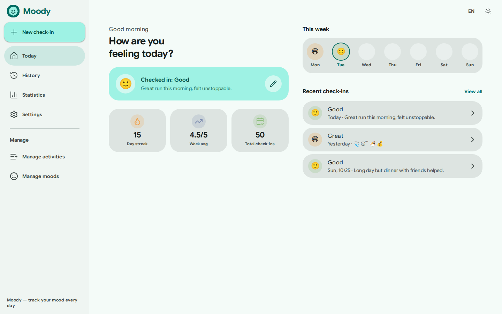
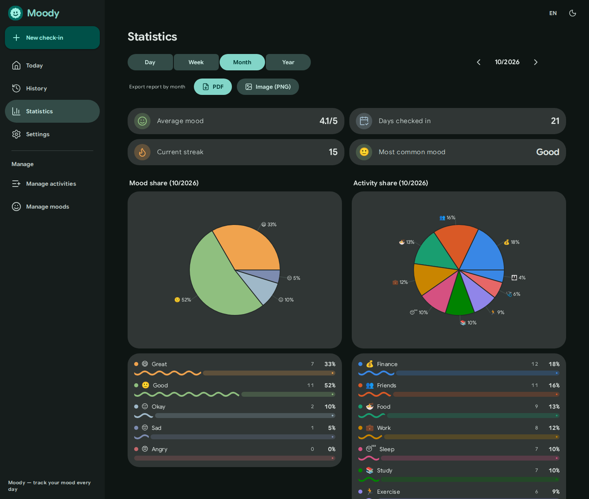
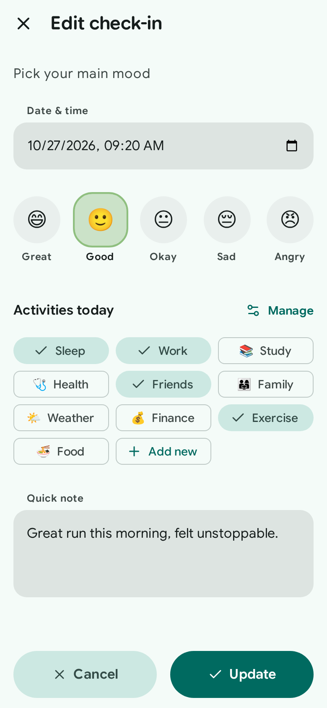
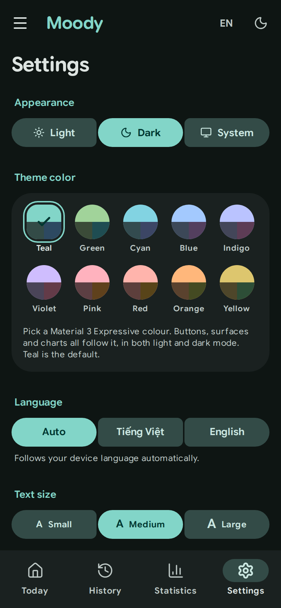

<div align="center">


# Moody

**Nhật ký tâm trạng tối giản, hiện đại**

Check-in mỗi ngày, nhìn lại xu hướng cảm xúc và xuất báo cáo. Giao diện sáng/tối, Tiếng Việt / English, cài đặt được như một PWA.

[English](README.md) · **Tiếng Việt**


<br />







</div>

---

## Mục lục

- [Giới thiệu](#giới-thiệu)
- [Ảnh chụp màn hình](#ảnh-chụp-màn-hình)
- [Tính năng](#tính-năng)
- [Hệ thống thiết kế](#hệ-thống-thiết-kế)
- [Trang giới thiệu và điều hướng](#trang-giới-thiệu-và-điều-hướng)
- [Toast theo theme](#toast-theo-theme)
- [PWA](#pwa)
- [Bắt đầu](#bắt-đầu)
- [Công nghệ](#công-nghệ)
- [Cấu trúc dự án](#cấu-trúc-dự-án)
- [Lệnh](#lệnh)
- [Triển khai](#triển-khai)
- [Trình duyệt hỗ trợ](#trình-duyệt-hỗ-trợ)
- [Đóng góp](#đóng-góp)
- [Giấy phép](#giấy-phép)

## Giới thiệu

Moody giúp bạn ghi lại tâm trạng trong vài giây: chọn 1 trong 5 mức cảm xúc, gắn các hoạt động trong ngày và thêm ghi chú. Xem lại dưới dạng danh sách, lịch tháng hoặc biểu đồ thống kê, hoặc xuất báo cáo PDF/PNG.

- **Không cần tài khoản** — chế độ khách lưu dữ liệu trong `localStorage`; đăng nhập Google để đồng bộ qua Firestore.
- **Ưu tiên di động, tốt trên máy tính** — thanh điều hướng dưới trên điện thoại, sidebar cố định và bố cục nhiều cột trên laptop.
- **Riêng tư** — dữ liệu thuộc về bạn: xuất/nhập CSV, Excel hoặc JSON bất cứ lúc nào.

## Ảnh chụp màn hình

| Desktop — Hôm nay (sáng) | Desktop — Thống kê (tối) |
|---|---|
|  |  |

| Mobile — Check-in (sáng) | Mobile — Cài đặt · màu chủ đề (tối) |
|---|---|
|  |  |

## Tính năng

| Khu vực | Mô tả |
|---|---|
| **Hôm nay** | Lời chào, trạng thái check-in, dải 7 ngày, chuỗi ngày liên tiếp, điểm trung bình tuần và các check-in gần đây |
| **Check-in** | Chọn ngày giờ, 1/5 cảm xúc, nhiều hoạt động và ghi chú tự giãn dòng; sửa được bất cứ lúc nào |
| **Lịch sử** | Dạng danh sách (tìm kiếm, bộ lọc, sắp xếp, vuốt để sửa/xóa) và dạng lịch tháng |
| **Thống kê** | Theo ngày / tuần / tháng / năm: xu hướng, tỉ lệ cảm xúc, hoạt động phổ biến |
| **Báo cáo** | Xuất PDF hoặc PNG gồm chỉ số chính và biểu đồ tròn |
| **Quản lý** | Hoạt động tùy chỉnh (kéo để sắp xếp) và đổi emoji / tên của 5 mức cảm xúc |
| **Trang giới thiệu** | Trang giới thiệu responsive, hiệu ứng khi cuộn, giao diện sáng/tối/hệ thống, Anh/Việt và đầy đủ meta SEO / chia sẻ mạng xã hội |
| **Cài đặt** | Giao diện sáng / tối / theo hệ thống, **màu chủ đề** (10 bảng màu Material 3 Expressive), cỡ chữ, ngôn ngữ, trang mở đầu, cài PWA, xuất / nhập dữ liệu |

## Hệ thống thiết kế

Moody theo phong cách **Material 3 Expressive (2026)**: bảng màu teal, shape bo góc lớn (thẻ 28 px, nút pill biến hình sang góc 12 px khi nhấn), typography nhấn mạnh bằng Google Sans Flex (trục bo tròn `ROND` cho tiêu đề), chuyển động kiểu lò xo, bề mặt phân tầng bằng sắc độ thay cho viền, và loading indicator biến hình. Icon nét mảnh ([Lucide](https://lucide.dev)).

**Nguồn màu duy nhất: [`src/styles/theme.css`](src/styles/theme.css)** — các vai trò màu Material 3 (`--md-*`, sáng + `.dark`) sinh từ seed teal mặc định `#009688` (primary `#006a60` sáng / `#82d5c8` tối), cùng thang shape và easing lò xo. Không nơi nào khác khai báo màu.

```
theme.css  ──►  index.css (vai trò --c-* + component)  ──►  tailwind.config.js  ──►  bg-surface · text-on-surface · bg-primary/10 …
(token --md-*)   ánh xạ vai trò, định nghĩa nút/FAB/…       ánh xạ vai trò thành class
```

- **Màu chủ đề (Cài đặt):** người dùng chọn một trong 10 bảng màu (mặc định teal, rồi xanh lá, xanh lơ, xanh dương, chàm, tím, hồng, đỏ, cam, vàng). Bảng màu được sinh sẵn trong [`src/lib/palettes.js`](src/lib/palettes.js) (scheme TonalSpot, sáng + tối) và áp lúc chạy bằng cách ghi đè token `--md-*`; thẻ `theme-color` của trình duyệt đổi theo màu nền đang dùng.
- Thêm/đổi màu: sửa `SEEDS` trong [`scripts/gen-theme.mjs`](scripts/gen-theme.mjs) rồi chạy `npm run gen:theme` — script ghi lại `palettes.js` và khối màu mặc định trong `theme.css`.
- Thang shape: `--shape-xs 4 · sm 8 · md 12 · lg 16 · xl 28 · xl-inc 32 · xxl 48 · full`, dùng qua class `rounded-*` của Tailwind.
- Chuyển động: `--spring-*-spatial` (nảy nhẹ, cho vị trí/kích thước/hình dạng) và `--spring-*-effects` (không nảy, cho màu/độ mờ); tôn trọng `prefers-reduced-motion`.
- App icon, favicon và ảnh OG sinh bằng [`scripts/build-icons.py`](scripts/build-icons.py) (hình "cookie" 12 múi + khuôn mặt, màu teal). `favicon.svg` tự đổi màu theo chế độ sáng/tối của trình duyệt.
- Màu biểu đồ đọc từ CSS được quy đổi sang hex qua canvas (`readRole()` trong `src/lib/theme.js`).

## Trang giới thiệu và điều hướng

| Trạng thái | Hành vi |
|---|---|
| Lần đầu / đã đăng xuất | Mở trang giới thiệu (`/#/welcome`). **Đăng nhập** → `/#/login`; **Bắt đầu** → chế độ khách. |
| Đã đăng nhập hoặc chế độ khách | Những lần sau vào thẳng ứng dụng, bỏ qua trang giới thiệu. |
| Cài đặt → Giới thiệu | Mở lại trang giới thiệu khi cần. |
| Đăng xuất | Quay về trang giới thiệu. |

Các thẻ chia sẻ (Open Graph, Twitter Card, JSON-LD, canonical, hreflang, `robots.txt`, `sitemap.xml`) trỏ tới URL triển khai **https://moody-mood-tracker.vercel.app/**.

## Toast theo theme

Toast là snackbar Material 3 (nền inverse surface, các biến thể icon `success` / `info` / `error`) và theo theme ở cả sáng và tối.


## Bắt đầu

Yêu cầu: **Node.js ≥ 18** và npm.

```bash
git clone https://github.com/minhtrong67/Moody-MoodTracker.git moody
cd moody
npm install
cp .env.example .env     # rồi điền cấu hình Firebase
npm run dev
```

Mở `http://localhost:5173`. **Chạy được khi chưa có Firebase** — app tự dùng chế độ khách (dữ liệu cục bộ).

### Cấu hình Firebase (tùy chọn)

1. Tạo project trong [Firebase Console](https://console.firebase.google.com).
2. **Authentication → Sign-in method** → bật **Google**.
3. **Firestore Database** → tạo cơ sở dữ liệu.
4. **Project settings → Your apps** → tạo Web app và chép các giá trị vào `.env`:

   | Biến | Ý nghĩa |
   |---|---|
   | `VITE_FIREBASE_API_KEY` | Web API key |
   | `VITE_FIREBASE_AUTH_DOMAIN` | `your-project.firebaseapp.com` |
   | `VITE_FIREBASE_PROJECT_ID` | Project ID |
   | `VITE_FIREBASE_STORAGE_BUCKET` | `your-project.appspot.com` |
   | `VITE_FIREBASE_MESSAGING_SENDER_ID` | Sender ID |
   | `VITE_FIREBASE_APP_ID` | App ID |
   | `VITE_SITE_URL` | URL triển khai, không có `/` cuối (canonical / Open Graph) |

5. Giới hạn Firestore để mỗi người chỉ truy cập dữ liệu của mình:

   ```
   rules_version = '2';
   service cloud.firestore {
     match /databases/{database}/documents {
       match /users/{userId}/{document=**} {
         allow read, write: if request.auth != null && request.auth.uid == userId;
       }
     }
   }
   ```

> ⚠️ `.env` đã nằm trong `.gitignore`. **Không bao giờ commit khóa/bí mật thật** lên repo công khai.

## Công nghệ

| Khu vực | Công nghệ |
|---|---|
| UI | React 18, React Router 6 (`HashRouter`) |
| Build / PWA | Vite 5, `vite-plugin-pwa` (Workbox) |
| Styling | Tailwind CSS 3 + token theme Material 3 |
| Chữ & icon | Google Sans Flex (`@fontsource-variable/google-sans-flex`, có tiếng Việt), `lucide-react` |
| Backend | Firebase Authentication (Google) + Cloud Firestore |
| Charts | Recharts |
| Báo cáo | `html2canvas-pro` + jsPDF (tải khi cần) |
| Nhập / xuất | `read-excel-file`, `write-excel-file`, `fflate` |
| i18n | Bộ dịch nhẹ tự viết (`src/i18n`) |

## Cấu trúc dự án

```
├── index.html                  # Meta SEO / Open Graph, script áp theme, màn hình khởi động
├── vite.config.js              # Vite + PWA (manifest) + tách chunk
├── tailwind.config.js          # Ánh xạ vai trò --c-* thành class Tailwind
├── public/
│   ├── sitemap.xml · robots.txt
│   ├── landing/                    # ảnh minh họa trang giới thiệu (webp, sáng/tối)
│   └── icons/ · favicon · og-image.png
├── screenshots/                # 4 ảnh dùng trong README
└── src/
    ├── styles/theme.css        # ★ token màu mặc định (teal), shape và chuyển động
    ├── lib/palettes.js         # sinh tự động — 10 bảng màu chủ đề chọn được
    ├── index.css               # vai trò suy ra, typography, nút, ô nhập, chuyển động
    ├── pages/Landing.jsx · Login.jsx   # trang giới thiệu · đăng nhập
    ├── lib/                    # session · theme · moodConfig · dateUtils · statsUtils · reportGenerator · dataTransfer
    ├── components/             # AppShell · Sidebar · Dialog · TextField · Switch · Login …
    ├── pages/                  # Dashboard · CheckIn · History · Statistics · Settings · Manage*
    ├── context/ · hooks/       # Auth, MoodEntries, Activities, Moods, Toast
    └── i18n/                   # vi.js · en.js
```

**Mô hình dữ liệu** — `users/{uid}/entries/{id}`: `date` (`YYYY-MM-DD`), `time` (ISO), `mood` (`great|good|okay|sad|angry`), `score` (1–5), `activities[]`, `note`. Hoạt động / cảm xúc tùy chỉnh nằm ở `users/{uid}/meta/*`; chế độ khách dùng `localStorage`.

## Lệnh

| Lệnh | Mô tả |
|---|---|
| `npm run dev` | Chạy dev server (HMR) |
| `npm run build` | Build production ra `dist/` |
| `npm run preview` | Xem thử bản build |

Thêm chữ: thêm key vào **cả** `src/i18n/en.js` và `src/i18n/vi.js`, rồi dùng `const {{ t }} = useI18n()`.

## Triển khai

Triển khai thư mục `dist/` lên bất kỳ static host nào (Vercel, Netlify, Cloudflare Pages, Firebase Hosting). Nhờ `HashRouter` nên không cần rewrite SPA. Đặt `VITE_SITE_URL` trước khi build và thêm domain vào Firebase **Authentication → Settings → Authorized domains** để đăng nhập Google.

## Trình duyệt hỗ trợ

Trình duyệt hiện đại. Theme dùng `color-mix()` và biến CSS: Chrome / Edge 111+, Safari 16.2+, Firefox 113+.

## Đóng góp

1. Fork repo và tạo nhánh: `git checkout -b feat/ten-tinh-nang`.
2. Bám theo hệ thống thiết kế: dùng token của theme (`bg-surface`, `text-on-surface-variant`, `text-brand`…), không hard-code màu.
3. Đảm bảo `npm run build` chạy được và thêm chữ UI cho cả hai ngôn ngữ.
4. Mở pull request mô tả thay đổi và lý do.

## Giấy phép

Phát hành theo [Giấy phép MIT](LICENSE) © 2026 minhtrong67.
